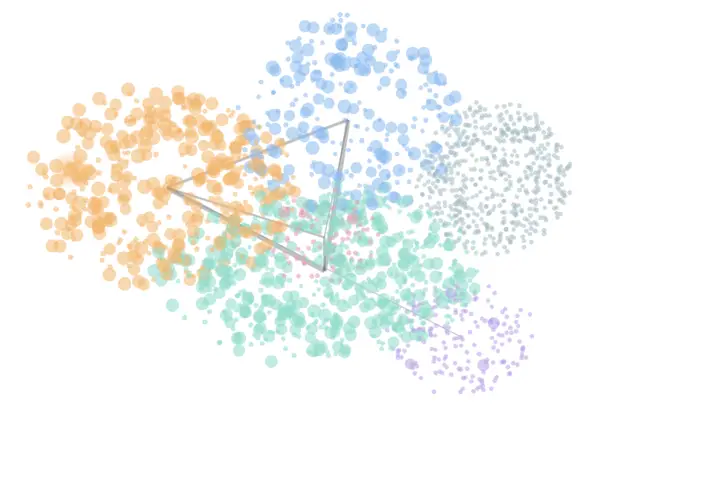

## Andres del Castillo

I work on AI agents that keep a long-term memory, and on machine learning and statistical software.

  <picture>
    <source media="(prefers-color-scheme: dark)" srcset="assets/brain-dark.webp">
    
  </picture>
   
  The shared memory my agents work from, as drawn by Brain Live. Each point is one record and lights up when an agent reads it. Labels are hidden.

### AI agents and machine learning

**[Brain framework](https://github.com/yspennstate/brain-framework-public)** is Yitzchak Shmalo's system that lets the AI agents on one machine share a long-term memory. They recall earlier work, consolidate it overnight, turn past mistakes into reflexes, and coordinate so they don't overwrite each other. I'm an early adopter and contributor. I run it every day across Codex and Claude Code and work with Yitzchak on testing and improving it, mostly on Brain Live, the live 3D view of the memory shown above.

**[SegViT](https://github.com/Andres42611/SegVit)** generates the transition between two songs using both of them, not just the one that's ending. I ran it as a pre-registered study, with every pass/fail threshold fixed before the test data was opened. Letting the model hear the next song measurably improves its predictions of the gap, and the gain holds for gaps from one to eight seconds. The [report](https://github.com/Andres42611/SegVit/blob/main/REPORT.md) has each result with its confidence interval.

### Statistical genetics

**[DNNaic](https://github.com/yspennstate/DNNaic)** is a deep learning method that tells which way genes flowed between two populations, which the standard statistics can't. Where gene flow is strong it calls the direction correctly 96.6% of the time in simulations, and it recovers a known case in butterflies. Paper and code with Yitzchak Shmalo.

**[PADZE](https://pypi.org/project/padze/)** (`pip install padze`) is a Python replacement for an older C++ tool for genetic diversity statistics. It reproduces the original's output and computes DNNaic's inputs.

**[Rab](https://github.com/Andres42611/Rab)** compares the load of harmful mutations between two populations. It was used in a [2024 study](https://doi.org/10.1093/gbe/evae130) of the island dingoes of K'gari.
